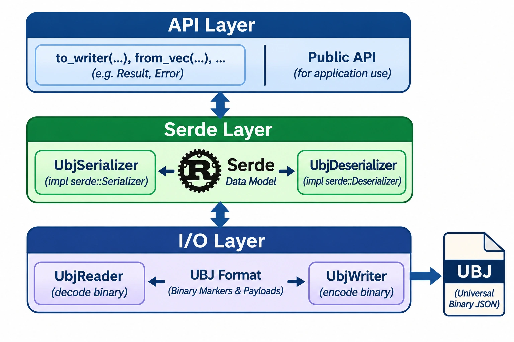

# Introduction

In this chapter we set the stage, clarifying who this book is for, how to read
it, and to expect. 

## Who this book is for

We assume an intermediate level of understanding, and practicality, of Rust's 
type system, error handling, fundamental traits, ownership and borrowing, 
lifetimes, and macros. The reader of this book should be already familiar with 
most concepts of the official <a href="https://doc.rust-lang.org/book/"
target="_blank" rel="noopener noreferrer">Rust Programming Language Book</a>,
except from smart pointers, concurrent/asynchronous programming and advanced 
traits.

We do *not* assume any prior knowledge of [Serde](https://serde.rs/) internals, 
neither we assume knowledge of the 
[UBJ - Universal Binary JSON](https://ubjson.org/) format. We introduce 
concepts from first principles, and we grow the complexity step by step.

## How to read this book

We recommend reading the chapters in order. The first three chapters set up the
problem and the architecture. The two middle parts build the I/O layer and
then the Serde layer, mirroring the order in which the real crate is engineered.
The final part covers the practical concerns that make the implementation
usable in the real world.

## What we are going to build

By the end of this book we will understand, layer by layer, how a Serde format
can be implemented in Rust language, starting from scratch. We will be 
creating a new Rust library, named <a href="https://crates.io/crates/serde-ubj"
target="_blank" rel="noopener noreferrer"><code>serde_ubj</code></a>, targeting 
one particular data format, the **UBJ - Universal Binary JSON**, and structuring
it from the ground up, through the following layers:



- **I/O Layer**  
  The lowermost layer, totally independent of Serde, with the new  `UbjReader` 
  and `UbjWriter` components, able to deal with the markers bytes and the 
  binary payloads defined by the official UBJ format specification (see <a 
  href="https://ubjson.org/" target="_blank" rel="noopener noreferrer">
  https://ubjson.org/</a>).

- **Serde Layer**  
  Built on top of the previous layer, the middle layer with the internal 
  `UbjSerializer` and `UbjDeserializer` components, respectively implementing 
   the canonical `serde::Serializer` and `serde::Deserializer` traits, able 
  to perform serialization of the so-called **Serde Data Model**;

- **API Layer**  
  The uppermost layer, the API - Application Programming Interface layer, 
  defining those few functions (e.g. `to_writer`, `from_vec`, etc.) and 
  few types (e.g. `Result`, `Error`, etc.) that our crate exposes to the 
  outside world, for public usage, while keeping everything else hidden down 
  below. 


## Does it support no_std environments

Yes, this books explains how to build the `serde_ubj` crate, and any other data 
format you wish, by approaching **`no_std` environments first**! 

It means that, rather that trying to retrofit `no_std` support after the 
most of the implementation is done, we demonstrate how to code for embedded 
devices and microcontrollers since the very first chapters of this book.


## How is going to be used
Rust developers will be able to use our library (more or less) like the 
following example:

```rust
use app::{Employee, Group};

fn main() -> Result<(), Box<dyn std::error::Error>> {

    // --- Serialize an employee -------

    let employee1 = Employee {
        name: String::from("John Brown"),
        age: 53, 
        groups: vec![Group::Leader]
    };
    let mut file1 = std::fs::File::create("emp1.ubj")?;
    
    let res1: /*<highlight>*/serde_ubj::Result<()>/*</highlight>*/ = 
      /*<highlight>*/serde_ubj::to_writer(&mut file1, &employee1)/*</highlight>*/;

    res1 match {
        OK(_) => println!("It worked")
        Err(/*<highlight>*/serde_ubj:Error::NotAsciiChar(c)/*</highlight>*/) => eprintln!("Nope!")
        Err(_) => eprintln!("Nope!")
    }
    
    
    // --- Deserialize an employee -------

    let bytes: Vec<u8> = std::fs::read("emp2.ubj")?;
    
    let employee2 = /*<highlight>*/serde_ubj::from_vec::<Employee>(bytes)/*</highlight>*/?;
    println!("{}", employee2)
}
```


Have a good reading!

