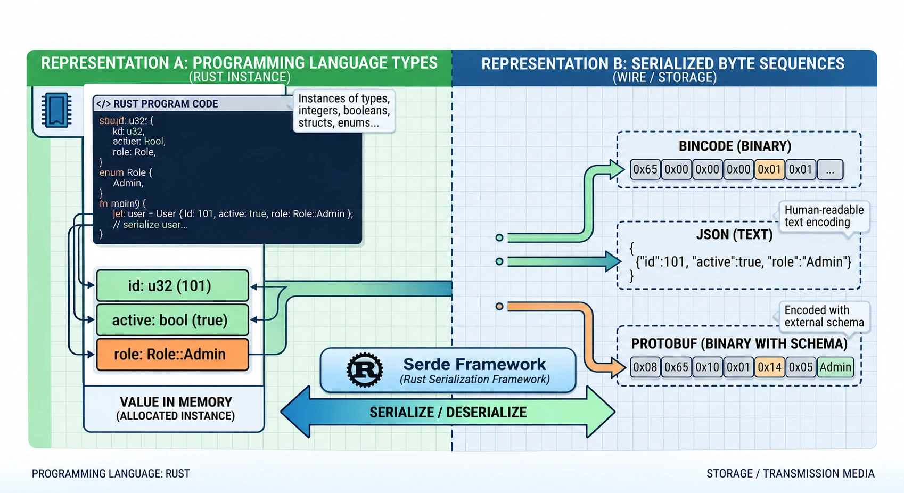

# Data Formats

In this chapter, we clarify what *data formats* actually are, why they are 
useful, how they are classified, and provide some info about a few of the most 
popular of them. 

## What is a Data Format

> [!NOTE]
> In software engineering, a **data format** is the standardized rule set,
> syntactic structure, and encoding scheme used to represent, store, transmit,
> and interpret data between different components, systems, or storage media. It
> defines how raw bits and bytes translate into meaningful, structured 
> information that applications can parse, process, and persist.

In simpler words, a data format is like a *contract* between programs (not
necessarily implemented using the same programming language) which want to store
or exchange data. The contract says which sequences of raw bytes are to be
considered valid, and what values those sequences translates to. A data format
is agnostic from the programming language, as it is all about representing
information as bytes.

### Textual vs Binary
Some data formats represent data using sequences of bytes displayable as 
plain-text characters (for example adopting the
<a href="https://www.rfc-editor.org/info/rfc3629/" target="_blank" 
rel="noopener noreferrer">UTF-8 Encoding</a>), making them human-readable, 
easy to inspect, debug, and log during development. Some other data formats,
instead, represent data into more compact byte arrays, optimizing for 
transmission speed, CPU parsing overhead, and storage footprint.

### Schema-Less vs Schema-Aware
Some data formats are schema-less or self-describing (with keys transmitted 
alongside values), while others rely on strict external schemas to guarantee
type safety, forward compatibility, and backward compatibility as systems evolve.

### Popular Data Formats
The following are just some of the most popular data formats of nowadays, 
starting from the text-based ones, and ending with the binary formats:

* **JSON - JavaScript Object Notation**     
  <a href="https://json.org" target="_blank" rel="noopener 
  noreferrer">https://json.org</a>, is a lightweight, text-based standard 
  designed for human-readable data interchange. It is natively supported 
  by web browsers and serves as the de facto standard format for RESTful APIs 
  and modern web applications.

* **YAML - YAML Ain't Markup Language**  
  <a href="https://yaml.org" target="_blank" rel="noopener
  noreferrer">https://yaml.org</a>, is a strictly indentation-driven, 
  human-friendly data serialization language heavily used for configuration 
  files, CI/CD pipelines, and Infrastructure-as-Code (IaC) tools like 
  Kubernetes and Docker Compose.

* **XML - eXtensible Markup Language**    
  <a href="https://www.w3.org/TR/xml/" target="_blank" rel="noopener
  noreferrer">https://www.w3.org/TR/xml/</a>, is a markup language that defines 
  strict syntax rules for encoding documents and structured data in a tag-based
  hierarchy. It is widely used in enterprise software, legacy SOAP web 
  services, and configuration manifests, and very often accompanied by 
  XML Schema definitions, <a href="https://www.w3.org/TR/xmlschema11-1/" 
  target="_blank" rel="noopener noreferrer">https://www.w3.org/TR/xmlschema11-1/</a>

* **CSV - Comma-Separated Values**  
  <a href="https://www.rfc-editor.org/info/rfc4180/" target="_blank" rel="noopener
  noreferrer">https://www.rfc-editor.org/info/rfc4180/</a>, is a simple, 
  tabular file format where data fields are separated by delimiters (typically
  commas). It is universally utilized for data exports, spreadsheets, and 
  database imports.

* **Protobuf - Protocol Buffers**  
  <a href="https://protobuf.dev/reference/protobuf/proto3-spec/" target="_blank"
  rel="noopener noreferrer">https://protobuf.dev/reference/protobuf/proto3-spec/</a>, 
  is Google's language-neutral, platform-neutral mechanism for serializing 
  structured data. It relies on a compiled schema (`.proto`) to generate
  extremely compact binary payloads, making it optimal for high-performance 
  gRPC microservices.

* **Apache Parquet**  
  <a href="https://parquet.apache.org/docs/" target="_blank" rel="noopener 
  noreferrer">https://parquet.apache.org/docs/</a>, is columnar storage format 
  optimized for heavy analytic workloads and big data processing frameworks
  (like Apache Spark and Hadoop), offering high compression rates and rapid 
  column-selective reads.

* **Apache Avro**  
  <a href="https://avro.apache.org/docs/" target="_blank" rel="noopener
  noreferrer">https://avro.apache.org/docs/</a>,is a row-oriented data 
  serialization system that bundles JSON-defined schemas directly inside
  its binary payloads. It is heavily favored in distributed streaming 
  platforms like Apache Kafka due to its robust support for seamless 
  schema evolution.

* **MessagePack**  
  <a href="https://msgpack.org" target="_blank" rel="noopener
  noreferrer">https://msgpack.org</a>, is an efficient binary serialization 
  format that acts like a compact, faster version of JSON, allowing applications
  to exchange data structures quickly without the overhead of text parsing.

The above list is not exhaustive, of course; there are many other data formats 
out there which we couldn't mention for brevity. And, there exists **UBJ - 
Universal Binary JSON** too (see <a href="https://ubjson.org/" target="_blank"
rel="noopener noreferrer">https://ubjson.org/</a>), which although not 
popular, is simple enough to be adopted by this book as case study for learning 
how to code in Rust with Serde.

### Usage of Data Formats
We may wonder: _"why so many data formats?"_. Reason for specifying so many 
is that each one is designed to address a particular use cases. The following
are the most common usages of the most popular data formats of nowadays:

* _Configuration & Metadata_:    
  TOML, YAML, JSON, and XML are typically used for application 
  configuration settings, deployment manifests, and 
 infrastructure-as-code definitions.

* _Network Interoperability & APIs_:     
  JSON as REST payloads, gRPC over HTTP/2 using Protocol Buffers, 
  and GraphQL schemas for client-server communication.

* _Data Engineering & Analytics_:       
  Apache Parquet, ORC, and CSV for columnar storage, high-throughput
  batch processing, and data warehousing.

## What is Serde
Serde is not a data format. It is considered a **serialization framework** that 
sits between our Rust data types, and any possible external data format (such 
as JSON, Avro, MessagePack, etc.).

A Rust program using the Serde framework can keep manipulating values held in 
memory as it would normally do. The values are still allocated as instances of 
Rust data types, such as integers, booleans, structs, enums, etc. And that's 
what we consider our **application data model**. Serde does not affect it.

From our program point of view, **serializing** with Serde is the act of 
walking our application data model values and emitting sequences of bytes able
to represent the same into a particular data format (such as UBJ or 
YAML).

On the other hand, **deserializing** is the act of reading a sequence of bytes,
structured according a particular data format (such as UBJ or YAML), and turning
the Rust values back into memory, in the types of our application data model.
