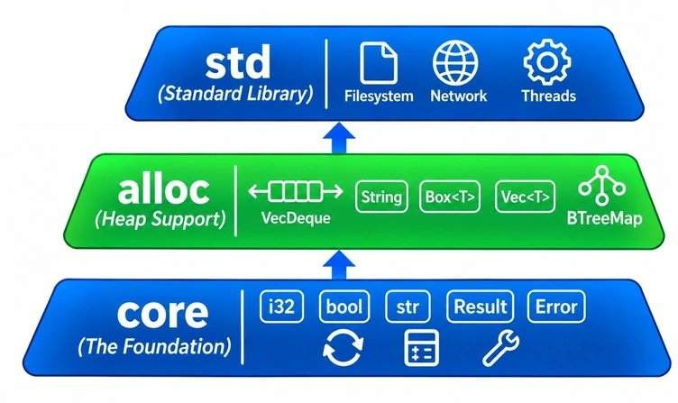

# Crate

> [!WARNING]
> This book is **under development**. Some chapters are still incomplete and
> the content may change without notice.

Once we have installed the <a href="https://rust-lang.org/tools/install/"
target="_blank" rel="noopener noreferrer">Rust toolchain</a>, we can get started 
and create our new library project by issuing the following command line:  

```sh
$ cargo new serde_ubj --lib
$ mkdir -p serde_ubj/tests
```

The above commands produce a brand new (yet empty) Cargo **crate** and the 
following minimal directory layout:

```text
serde_ubj
├── Cargo.toml
├── src
│    └── lib.rs
└── tests
```

A Cargo crate is the fundamental unit of compilation, distribution, and code
organization in the Rust ecosystem. When we write Rust code, we organize it 
into crates, like the one we just created abbove.

A crate can come in two forms:

* **binary crate**: an executable program that compiles down to an application 
  we can run (it contains a `main()` function and a `main.rs` file).

* **library crate**: a collection of shared code, modules, and APIs designed to 
  be used by other programs or libraries (it contains a `lib.rs` file, like the 
  custom Serde format library we build).

A single project (managed by Cargo) can contain one library crate, multiple 
binary crates, or both.

The `Cargo.toml` file is the manifest file for our crate. It uses the TOML 
format to tell Cargo (Rust's build system and package manager) everything it 
needs to know about how to build, test, and publish our project.

Writing and maintaining a `Cargo.toml` is essential for several key reasons, 
such as defining package metadata and publishing, dependency management, 
features and conditional compilation.

## Metadata  
Since we want to share our library with the world on <a 
href="https://crates.io" target="_blank" rel="noopener noreferrer">
crates.io</a>, `Cargo.toml` holds all the necessary package metadata, such as 
our crate's name, version,  authors, license, repository URL, and keywords.

```toml
# file: Cargo.toml

[package]
    name = "serde_ubj"
    version = "0.1.0"
    edition = "2024"
    license = "WTFPL"
    authors = [
        "Paolo Angioletti <paolo.angioletti@gmail.com>"
    ]
    description = "Universal Binary JSON data format for Rust with Serde (both `std` and `no_std`)."
    repository = "https://github.com/pangiole/serde-ubj"
    keywords = [
        "serde",
        "serialization",
        "ubj",
        "ubjson",
        "json"
    ]
    categories = [
        "encoding"
    ]
```    

## Dependencies
Our `serde_ubj` library crate needs to depend on the Serde framework crate, 
of course. Therefore, we issue the following command line:

```sh
cargo add serde --no-default-features
```

Cargo automatically downloads the source code of the Serde framework (at its
best version possible), handles transitive dependencies (by eventually 
downloading more source code), and ensures reproducible builds by generating 
the `Cargo.lock` file.

It's worth mentioning that, since we wish to pull down a minimal amount of Serde
framework capabilities (and transitively related dependencies), we disable all 
Serde default features, and not activating any of them (for now). 

```toml
# file: Cargo.toml

[dependencies]
    serde = { 
        version = "1.0.229", 
        default-features = false, 
        features = []
    }
```

This _"frugal"_ approach paves the way to targeting not only standard 
environments, like fully functional operating systems (such as Linux, macOS, and
Microsoft Windows), but also targeting the so-called `no_std` environments, such
as embedded devices and microcontrollers.

In fact, another essential dependency we build our solution upon is the
<a href="https://crates.io/crates/embedded-io" target="_blank" 
rel="noopener noreferrer">Embedded I/O library</a>.

```toml
# file: Cargo.toml

[dependencies]
    # serde = ...

    embedded-io = {
        version = "0.7.0",
        default-features = false,
        features = []
    }
    embedded-io-adapters = {
        version = "0.7.0",
        default-features = false,
        features = [],
        optional = true
    }
```

These additional dependencies define I/O traits for embedded devices and 
microcontrollers. Since Rust's standard I/O traits are **not** available in 
less capable environments, the `embedded-io*` crates provide replacement 
equivalent traits, usable everywhere. Therefore, we simply forget about the 
standard I/O library and code with those replacements. 

> [!IMPORTANT]
> Instead of relying upon the Rust Standard I/O Library, and despite someone 
> could argue against, we are going to base the whole implementation of our 
> `serde_ubj` create upon the I/O replacement traits of the `embedded-io` 
> library!
 

## Features
Cargo features are Rust's built-in mechanism for conditional compilation and 
optional dependencies. They allow us to bundle optional capabilities into our 
crate so that users only compile — and pay the dependency cost for — what they
actually need to use.

Before coding our `Cargo.toml` manifest with custom features, we should quickly
remind ourselves how Rust organizes its own built-in compiler crates:

* `core` (always available):  
  The absolute foundation of Rust. It provides primitive types (such as `i32`,
  `bool`, `str`, etc.), error handling (like `Result` and `Error`), iterators,
  math functions, and many other basic utilities. It requires zero operating
  system support and zero heap memory allocation.

* `alloc` (optional heap support):  
  Provides dynamic heap-allocated linear data structures (like `Vec<T>` and
  `String`), smart pointers (such as `Box<T>`, `Rc<T>`, etc.) and more complex
  data structure (like `VecDeque<T>`, `BTreeMap`, etc.). It requires a global
  memory allocator, but still does not require an operating system.

* `std` (the standard library):  
  Built on top of `core` and `alloc`, plus OS-specific services like file I/O,
  networking, threads, and process management. When we write a normal Rust
  program, `std` is included implicitly.



With the knowledge of Rust built-in crates refreshed, we can finally code our 
`Cargo.toml` manifest with some useful features, as follows:

```toml
# file: Cargo.toml

[features]
  default = ["std"]

  # Targets standard environments
  std = [
    "alloc",
    "serde/std",
    "embedded-io-adapters/std"
  ]

  # Targets no_std with heap-allocator environments 
  alloc = [
    "serde/alloc",
    "embedded-io/alloc"
  ]

  # Targets strictly no_std enviornments
  no_std = [
      
  ]
```

In the above `Cargo.toml` manifest, our crate is specified with four features: 
`default`, `std`, `alloc` and `no_std`. The `default` feature gets automatically 
activated when users add our crate normally, without specifying the
`--no-default-features` option, such as in:

```sh
$ cargo add serde_ubj
```

Activating our `default` feature translates into activating our `std` feature, 
which in turn activates our `alloc`, `serde/std` and `embedded-io-adapters/std` 
features too. Instead, activating our `alloc` feature in turn activates the 
`serde/alloc` and `embedded-io/alloc` features too. Finally, activating our 
`no_std` feature translates into no features at all (which is the most 
restrictive build ever).


Note how we have specified the `std` feature to make it act  as the bridge to 
the <a href="https://doc.rust-lang.org/std/" target="_blank" rel="noopener 
noreferrer">Rust standard library</a>. When enabled (usually by default), it 
tells our crate:

* It can use operating system handles, threading, and standard I/O (see 
  the `std::io` Rust module), and heap allocation

* It should propagate the `std` flag to external dependencies (for example, 
  `serde/std`), letting them unlock features that also require the Rust 
  standard library.

While enabling the `std` feature is the most common use case scenario, we 
need to implement a solution for those users who need to target so-called 
`no_std` environments too. These environments usually run onto embedded devices 
and microcontrollers; they cannot rely upon the presence of the Rust Standard 
Library, although they may (or may not) use a global memory allocator.


## Root
The so-called **crate root** simply is the `src/lib.rs` file, and this how 
we code its top section:

```rust
// file: src/lib.rs

// If the "std" Cargo feature is NOT active, apply the no_std attributes.
#![cfg_attr(not(feature = "std"), no_std)]

// Bring heap allocation types (String, Vec, Box) into scope whenever 
// the "alloc" Cargo feature is activated
#[cfg(feature = "alloc")]
extern crate alloc;

// (Optional) Explicitly reference the std Rust crate when "std" Cargo feature 
// is activated, though standard library items are in the prelude by default.
#[cfg(feature = "std")]
extern crate std;
```

We adopt the `#[cfg...` attributes to conditionally compile sections of Rust 
code depending on which Cargo features got activated.

Rust **conditional** compilation is a powerful mechanism that allows us to
include or exclude specific blocks of code, modules, or dependencies at compile
time based on a set of conditions (such as target architecture, operating
system, or custom Cargo features).

Rust provides a few primary attributes and macros to handle conditional
compilation:

* `#[cfg(...)]` Attribute:  
  Placed above items (functions, structs, modules, fields) to include them
  only when the condition evaluates to true.

* `#[cfg_attr(condition, attribute)]`:  
  Conditionally applies an attribute (like the `no_std` attribute, or deriving
  a trait) only if the condition is met.

* `cfg!(...)` Macro:   
  Evaluates to a boolean (true or false) at compile time, allowing us to
  use it inside standard if statements for branch pruning by the optimizer.

To match our `Cargo.toml` manifest features, our crate root file needs
conditional compilation attributes to handle the absence of `std` and to
conditionally pull in the `alloc` crate when requested.

