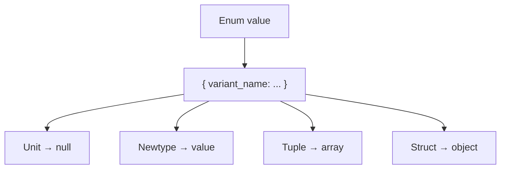
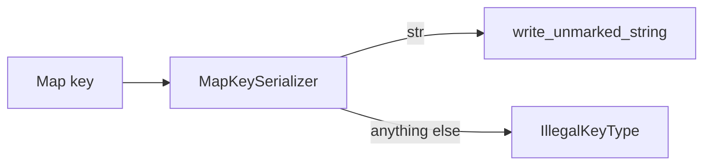

# Serializer

> [!WARNING]
> This book is **under development**. Some chapters are still incomplete and
> the content may change without notice.

In this chapter we climb from raw bytes (the data format) to the Serde
framework. We explain what serialization actually means and how to implement it
in Rust with Serde, starting from the type that does the work — the
`UbjSerializer` — and finishing with the free functions that the API layer
re-exports.

## What is serialization

Programs manipulate values held in memory, allocated as instances of Rust data
types, such as integers, booleans, structs, enums, and so on. From the program's
point of view, _**serializing**_ is the act of walking a value in memory and
emitting an outgoing sequence of bytes that represent the same value in a
specific external data format (Bincode, JSON, ProtoBuf, …).


The main intent of serialization is either storing the data (to a file on the
local filesystem) or transmitting it over the wire to another application that
receives it.

## Struct

According to the Serde framework, we provide an implementation of the
`serde::Serializer` trait for one of our types, which we call `UbjSerializer`.
Our type is tiny; everything interesting happens in the trait implementation: it
receives a stream of typed events and turns each one into calls on the
`UbjWriter` we built earlier.

```rust
// file: src/internal/serde/ser.rs
use crate::internal::io::writer::UbjWriter;
use embedded_io::{Write as Sink};

/// The UBJ serializer
struct UbjSerializer<S> where S: Sink {
    writer: UbjWriter<S>,
}
```

We implement the trait for `&mut UbjSerializer<S>`, not for the value itself.
That is the usual Serde pattern: it lets compound serializers borrow the same
underlying state instead of moving it around.

```rust
// file: src/internal/serde/ser.rs

impl<S> serde::Serializer for &mut UbjSerializer<S> where S: Sink {
    type Ok = ();
    type Error = UbjError;
    // ...
}
```

## Factories

Rust does not allow function overloading (same name, different argument types),
so a single `new()` function implementation must be conditionally selected per
compiler configuration, via the `#[cfg]` attribute. The `UbjSerializer<S>`
struct is generic over any sink `S: Sink` (our alias for `embedded_io::Write`),
but the *factory* is compiled differently depending on which Cargo feature is
activated.

Under `no_std` (with or without `alloc`), `new` is generic over
`embedded_io::Write` itself, accepting a non-allocating `&mut [u8]` slice or,
when `alloc` is enabled, a growable heap-allocated `Vec<u8>`:

```rust
// file: src/internal/serde/ser.rs

#[cfg(not(feature = "std"))]
impl<S> UbjSerializer<S>
where S: Sink
{
    fn new(sink: S) -> Self {
        Self {
            writer: UbjWriter::new(sink)
        }
    }
}
```

Under the `std` feature, `new` is generic over `std::io::Write` and internally
wraps the caller's writer in `embedded_io_adapters::std::FromStd`, so callers
can pass standard I/O types such as a `Cursor`, a `File`, or a `TcpStream`
directly:

```rust
// file: src/internal/serde/ser.rs

#[cfg(feature = "std")]
impl<W> UbjSerializer<embedded_io_adapters::std::FromStd<W>>
where W: std::io::Write
{
    fn new(writer: W) -> Self {
        Self {
            writer: UbjWriter::new(writer)
        }
    }
}
```

The interface of the factory function stays identical in shape —
`UbjSerializer::new(sink)` — while the accepted sink type automatically widens
or narrows with the target environment. A caller never writes conditional code;
they simply pass whatever buffer or stream their platform offers, and the
correct implementation is chosen at compile time.

If the internal _"adapting"_ mechanism is still not clear then read the
[Writing / Factories / Adapting](../05-io-layer/05-writer.md#adapting) section
of this book once again.

## Scalars

Most scalar methods are one-line delegations. A few deserve attention:

- **unsigned widening**
  `u16` is written with `write_int32` and `u32` with `write_int64`, because UBJ
  has no unsigned markers wider than a byte. The optimized integer path then
  shrinks them again when possible.

- **`u64` overflow**
  values above `i64::MAX` cannot be represented, so they produce
  `UbjError::Unsupported` instead of wrapping.

- **128-bit integers**
  both `i128` and `u128` are rejected for the same reason.

- **`serialize_bytes`**
  it is still a `todo!()`. Plain `Vec<u8>` does not reach it — only wrappers
  such as `serde_bytes::Bytes` do.

## Compound values

All the associated `Serialize*` types are set to `Self`, so one type can serve
every compound shape. The construction methods simply open a container:

- **sequence, tuple, tuple struct**
  write the `[` marker and return `self`;

- **struct and map**
  write the `{` marker and return `self`;

- **unit struct**
  write `null`, because it carries no data;

- **newtype struct**
  disappear entirely and serialize the wrapped value.

## Enums

Enums are encoded as a one-entry object whose key is the variant name. The value
depends on the variant shape:

```rust
fn serialize_unit_variant(
    self, _name, _variant_index, variant_name
) -> Result<(), UbjError> {
    self.writer.write_start_object()?;
    self.writer.write_unmarked_string(variant_name)?;
    self.writer.write_null()?;
    self.writer.write_end_object()
}
```

A newtype variant stores the payload directly, a tuple variant stores an array,
and a struct variant stores a nested object.



## The compound trait impls

Each `Serialize*` companion has two jobs: serialize its elements, and close the
container.

- **`SerializeSeq`, `SerializeTuple`, `SerializeTupleStruct`**
  every element is forwarded to `value.serialize(&mut **self)`, and `end` writes
  `]`.

- **`SerializeStruct`**
  each field writes its key as an *unmarked* string (object keys never carry the
  `S` marker) and then the value; `end` writes `}`.

- **`SerializeStructVariant`**
  `end` writes two `}` markers, closing the inner object and the variant object.

## Maps and the key problem

UBJ object keys are strings, but Serde happily asks to serialize an integer key.
We solve this with a second, deliberately limited serializer: the
`MapKeySerializer`.

```rust
struct MapKeySerializer<'s, W> where W: Sink {
    ubj_serializer: &'s mut UbjSerializer<W>,
}
```

Only `serialize_str` succeeds. Every other scalar returns
`UbjError::IllegalKeyType`, and every compound associated type is
`serde::ser::Impossible`, which makes illegal shapes unrepresentable at the type
level. It is a neat example of using the type system to enforce a format rule.



## The public entry points

Three free functions wrap the whole thing, and the API layer re-exports them
under `#[cfg]` gates that mirror their requirements:

- **`to_writer(&mut writer, &value)`** — `std`
  builds the serializer and serializes the value. It does **not** flush: a
  caller that supplies a buffering `std::io::Write` is expected to flush it
  itself once serialization returns.

- **`to_vec(&value)`** — `alloc`
  serializes into a fresh `Vec<u8>` and returns it.

- **`to_slice(&value, &mut buf)`** — no heap
  serializes into a caller-provided byte slice and returns the number of bytes
  written.

```rust
// file: src/internal/serde/ser.rs

#[cfg(feature = "std")]
pub fn to_writer<W, T>(write: &mut W, value: &T) -> Result<(), UbjError>
where
    W: std::io::Write,
    T: serde::Serialize
{
    let mut serializer = UbjSerializer::new(write);
    value.serialize(&mut serializer)
}
```

```rust
// file: src/internal/serde/ser.rs

#[cfg(feature = "alloc")]
pub fn to_vec<T>(value: &T) -> Result<alloc::vec::Vec<u8>, UbjError>
where
    T: serde::Serialize,
{
    let mut vec = alloc::vec::Vec::new();
    let mut serializer = UbjSerializer::new(&mut vec);
    value.serialize(&mut serializer)?;
    Ok(vec)
}
```

`to_slice` uses the `&mut [u8]` sink directly: it keeps a local slice of the
still-unwritten tail, serializes into it, and reports how much was consumed.

```rust
// file: src/internal/serde/ser.rs

pub fn to_slice<T>(value: &T, buf: &mut [u8]) -> Result<usize, UbjError>
where
    T: serde::Serialize,
{
    let original_len = buf.len();

    // Keep a local slice referring to the still-unwritten part of `buf`. The `&mut [u8]` sink
    // implementation advances it as bytes get written, so its final length tells us how many
    // bytes were consumed.
    let mut remaining: &mut [u8] = buf;
    {
        let mut serializer = UbjSerializer::new(&mut remaining);
        value.serialize(&mut serializer)?;
    }

    Ok(original_len - remaining.len())
}
```

Notice that `to_writer` does not wrap the writer in a `BufWriter`. Avoiding
accidental double buffering is a deliberate choice, and the documentation asks
callers to provide their own buffering when they need it. For the same reason it
never flushes that buffer: the caller owns the sink, so flushing — and deciding
how to react to a flush failure — is left entirely to the caller.
